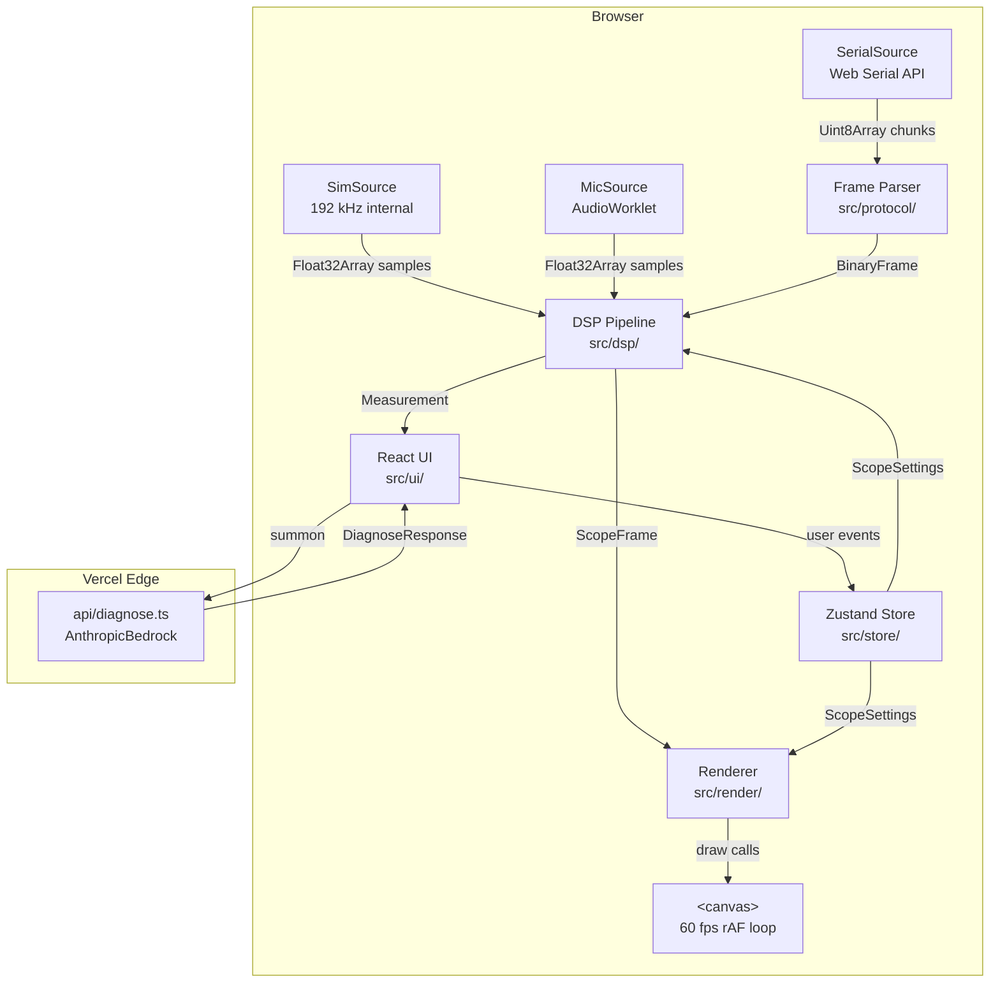
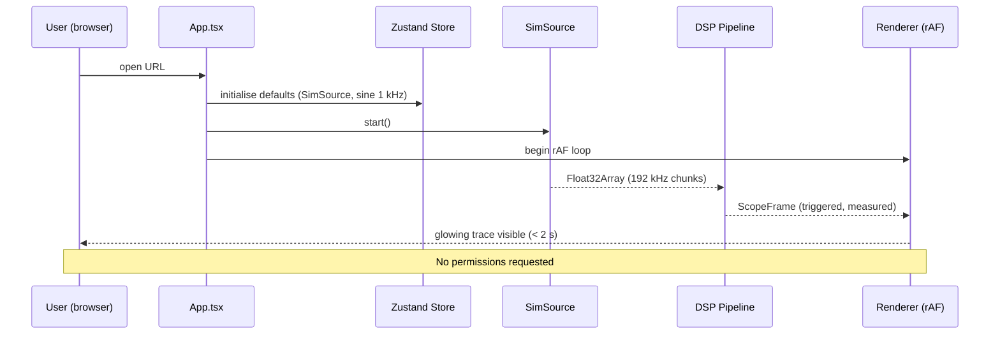
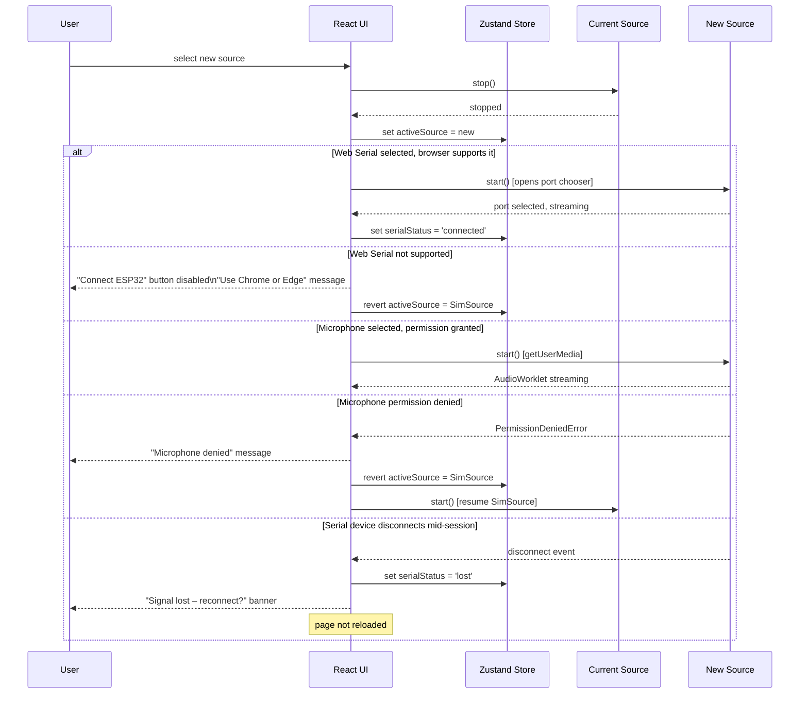
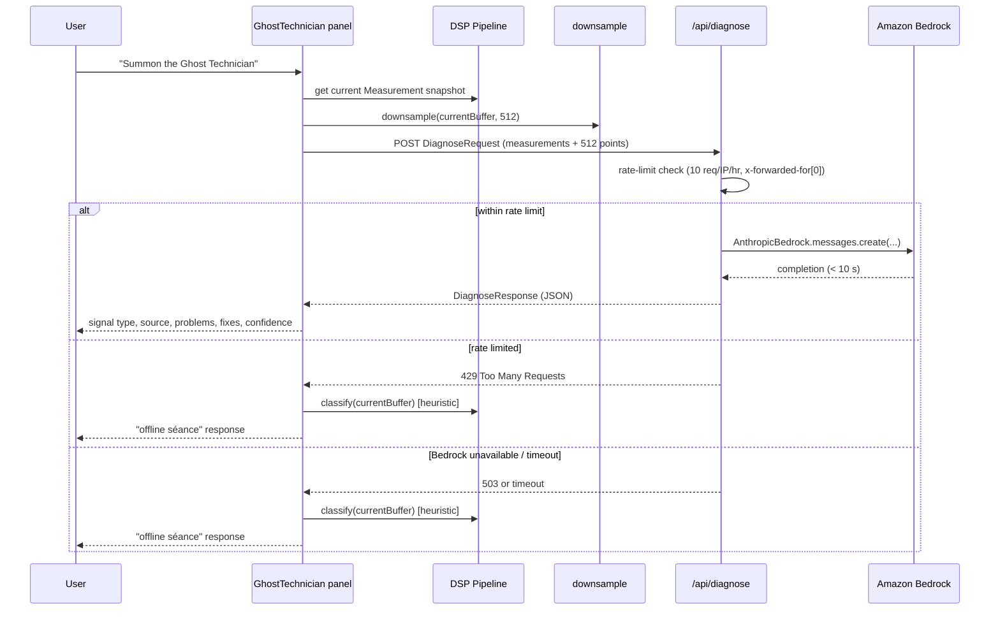
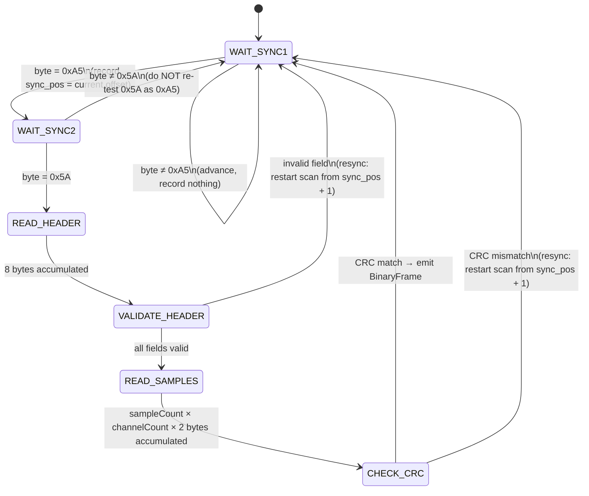

# Design Document: Ghost Scope

## Overview

Ghost Scope is a browser-based oscilloscope with an analog CRT phosphor aesthetic. It
accepts samples from three sources — a built-in signal simulator, the system microphone,
and an ESP32 over Web Serial — and renders them as a glowing phosphor trace on a single
`<canvas>` element driven by a `requestAnimationFrame` loop. A DSP pipeline running in
plain TypeScript handles trigger detection, eight automatic measurements, and FFT analysis.
An AI "Ghost Technician" (Vercel serverless → Amazon Bedrock Claude) explains the signal;
a local heuristic classifier provides an offline fallback.

The app must be fully usable without hardware: judges open a URL and see a live trace
within two seconds with no permissions requested.

---

## Architecture

### System Diagram



### Component Roles

| Component | Location | Role |
|-----------|----------|------|
| `SimSource` | `src/sources/SimSource.ts` | Generates waveform samples at 192 kHz; supports 10 waveform types |
| `MicSource` | `src/sources/MicSource.ts` | Captures microphone via `getUserMedia` + `AudioWorklet` |
| `SerialSource` | `src/sources/SerialSource.ts` | Opens Web Serial port, feeds raw bytes to the frame parser |
| `frameParser` | `src/protocol/frameParser.ts` | State-machine decoder for the binary ESP32 frame format |
| `trigger` | `src/dsp/trigger.ts` | Finds the trigger point in a sample buffer |
| `measurements` | `src/dsp/measurements.ts` | Computes 8 metrics via Schmitt-trigger zero-crossing |
| `fft` | `src/dsp/fft.ts` | Radix-2 FFT with window functions and peak labelling |
| `downsample` | `src/dsp/downsample.ts` | Min-max bucketing for display and AI payload reduction |
| `classify` | `src/dsp/classify.ts` | Heuristic offline signal classifier |
| `phosphorRenderer` | `src/render/phosphor.ts` | Offscreen compositing: decay + glow + sharp trace |
| `graticule` | `src/render/graticule.ts` | 10×8 division grid, labels, cursors |
| `Zustand store` | `src/store/scopeStore.ts` | All user-adjustable settings; source of truth for DSP and render |
| `GhostTechnician` | `src/ui/GhostTechnician.tsx` | Panel that calls `/api/diagnose` and shows the reply |
| `api/diagnose.ts` | `api/diagnose.ts` | Vercel serverless: rate limiting, Bedrock call, JSON response |

### 5-Step Data Flow

1. **Acquire** — the active `SignalSource` pushes `Float32Array` sample batches (or raw bytes for `SerialSource`) at its native rate.
2. **Parse** — `SerialSource` feeds bytes through `frameParser`, which emits validated `BinaryFrame` objects; other sources emit samples directly.
3. **Process** — the DSP pipeline applies the trigger algorithm, computes measurements, and optionally runs the FFT, producing a `ScopeFrame` per display cycle.
4. **Render** — the `rAF` loop reads the latest `ScopeFrame` from a double-buffer and calls `phosphorRenderer`, which composites decay + glow + sharp trace onto the main canvas.
5. **Explain** — on demand, the UI sends a `DiagnoseRequest` (measurements + 512-point downsampled trace) to `/api/diagnose` and renders the `DiagnoseResponse` in the Ghost Technician panel.

---

## 3. Sequence Diagrams

### App Startup (SimSource default)



### Source Switch with Error Paths



### Ghost Technician Summon



---

## Components and Interfaces

### `SignalSource` Interface

```typescript
/** Lifecycle: start() → push samples → stop(). */
export interface SignalSource {
  /** Human-readable name shown in the UI source selector. */
  readonly name: string;

  /** True while the source is actively producing samples. */
  readonly isRunning: boolean;

  /**
   * Register a callback that receives new sample batches.
   * Called at the source's native rate; callback must return quickly.
   * ch1 and ch2 have the same length; ch2 is an empty Float32Array
   * when only one channel is available.
   */
  onSamples: (ch1: Float32Array, ch2: Float32Array, sampleRateHz: number) => void;

  /** Called when the source encounters a non-recoverable error. */
  onError: (err: Error) => void;

  /** Begin producing samples. Returns a promise that resolves once running. */
  start(): Promise<void>;

  /** Stop producing samples. Safe to call if already stopped. */
  stop(): void;
}
```

## Data Models

```typescript
/** One display-ready frame after trigger alignment and measurement. */
export interface ScopeFrame {
  /** Trigger-aligned samples for channel 1 (display window length). */
  ch1: Float32Array;
  /** Trigger-aligned samples for channel 2 (same length as ch1; zeros if unavailable). */
  ch2: Float32Array;
  /** Sample rate of the data in this frame (Hz). */
  sampleRateHz: number;
  /** Index within ch1 at which the trigger fired. */
  triggerIndex: number;
  /** Computed measurements for ch1. */
  measurements: Measurement;
  /** Wall-clock timestamp (performance.now()) when the frame was produced. */
  timestamp: number;
}

/** All 8 automatic measurements for one channel. */
export interface Measurement {
  /** Fundamental frequency in Hz, or null if undetermined. */
  frequencyHz: number | null;
  /** Period in seconds, or null. */
  periodS: number | null;
  /** Peak-to-peak voltage (or dBFS for MicSource). */
  vpp: number;
  vmin: number;
  vmax: number;
  vmean: number;
  vrms: number;
  /** Fraction [0, 1], or null if signal is not binary-like or < 2 periods. */
  dutyCycle: number | null;
}

/** Zustand store shape (ScopeSettings + runtime state). */
export interface ScopeStore {
  // Source
  activeSource: 'sim' | 'mic' | 'serial';
  simWaveform: 'sine' | 'square' | 'triangle' | 'saw' | 'noise' | 'pwm' | 'am' | 'fm' | 'haunted' | 'i2c';
  simFrequencyHz: number;      // 1 – 96000
  simAmplitudeV: number;
  simOffsetV: number;
  simNoiseLevel: number;       // 0 – 1

  // Timebase
  timePerDivS: number;         // e.g. 0.001 for 1 ms/div
  voltsPerDivCh1: number;
  voltsPerDivCh2: number;
  offsetVCh1: number;
  offsetVCh2: number;

  // Trigger
  triggerMode: 'auto' | 'normal' | 'single';
  triggerEdge: 'rising' | 'falling';
  triggerLevelV: number;
  triggerHoldoffS: number;

  // Display
  ch1Visible: boolean;
  ch2Visible: boolean;
  fftVisible: boolean;
  cursorsVisible: boolean;
  cursor1TimeS: number;
  cursor2TimeS: number;
  cursor1VoltV: number;
  cursor2VoltV: number;

  // Render effects
  persistenceAlpha: number;    // 0 – 1 (decay fill alpha; 0 = instant clear)
  glowBlurPx: number;
  scanlinesVisible: boolean;
  vignetteVisible: boolean;
  reducedMotion: boolean;
  highContrast: boolean;

  // Runtime (non-persisted)
  running: boolean;
  serialStatus: 'disconnected' | 'connecting' | 'connected' | 'lost';
  serialLinkKSps: number;      // effective kS/s, shown in status bar
  singleCaptureReady: boolean;

  // Actions
  setSource(s: ScopeStore['activeSource']): void;
  setRunning(r: boolean): void;
  toggleRunning(): void;
  applySettings(partial: Partial<ScopeStore>): void;
}

/** Decoded binary frame from the ESP32. */
export interface BinaryFrame {
  frameType: 0x01;
  channelCount: 1 | 2;
  sampleRateHz: number;        // 1 – 2_000_000
  /** Interleaved: ch1[0], ch2[0], ch1[1], ch2[1], ... (12-bit values, 0–4095). */
  samples: Uint16Array;
  sampleCount: number;         // 1 – 4096
}

/** Payload sent to /api/diagnose. */
export interface DiagnoseRequest {
  measurements: Measurement;
  sourceType: 'sim' | 'mic' | 'serial';
  /** Downsampled to ≤ 512 points (Float32Array serialised as number[]). */
  traceSamples: number[];
  sampleRateHz: number;
  timePerDivS: number;
  voltsPerDivCh1: number;
}

/** Response from /api/diagnose. */
export interface DiagnoseResponse {
  signalType: string;
  likelySource: string;
  problems: string[];
  suggestedFixes: string[];
  /** 'high' | 'medium' | 'low' | 'unsure' */
  confidence: 'high' | 'medium' | 'low' | 'unsure';
  /** True when the response came from the local classifier. */
  isOffline: boolean;
}
```

---

## 5. Low-Level Design

### 5.1 Phosphor Rendering

**Three canvases:**

| Canvas | Variable | Usage |
|--------|----------|-------|
| Main visible canvas | `mainCanvas` | The element the user sees |
| Trace offscreen | `traceCanvas` | Current frame's trace only, cleared each frame |
| Glow offscreen | `glowCanvas` | Blurred copy of traceCanvas for the glow composite |

**Per-frame pipeline (`src/render/phosphor.ts`):**

```typescript
function renderFrame(mainCtx, traceCtx, glowCtx, frame, settings) {
  const { persistenceAlpha, glowBlurPx, highContrast, reducedMotion } = settings;

  // 1. Clear traceCanvas and draw just the new trace segment
  traceCtx.clearRect(0, 0, W, H);
  drawTrace(traceCtx, frame);           // thin bright line, e.g. #00ff88

  // 2a. Decay pass on mainCanvas
  //     reducedMotion → fill fully opaque black (persistence = 0)
  const alpha = reducedMotion ? 1.0 : persistenceAlpha;
  mainCtx.globalCompositeOperation = 'source-over';
  mainCtx.fillStyle = `rgba(0,0,0,${alpha})`;
  mainCtx.fillRect(0, 0, W, H);

  if (!highContrast) {
    // 2b. Glow layer (blurred trace composited with 'lighter')
    glowCtx.clearRect(0, 0, W, H);
    if (supportsFilter) {
      glowCtx.filter = `blur(${glowBlurPx}px)`;
      glowCtx.drawImage(traceCanvas, 0, 0);
      glowCtx.filter = 'none';
    } else {
      // Fallback: shadowBlur on traceCanvas context
      traceCtx.shadowBlur = glowBlurPx * 2;
      traceCtx.shadowColor = '#00ff88';
      // re-draw trace with shadow, then copy to glowCanvas
      glowCtx.drawImage(traceCanvas, 0, 0);
      traceCtx.shadowBlur = 0;
    }
    mainCtx.globalCompositeOperation = 'lighter';
    mainCtx.drawImage(glowCanvas, 0, 0);
  }

  // 2c. Sharp trace layer
  mainCtx.globalCompositeOperation = 'source-over';
  mainCtx.drawImage(traceCanvas, 0, 0);

  // 3. Static overlays (scanlines, vignette, graticule, cursors)
  if (settings.scanlinesVisible && !highContrast) drawScanlines(mainCtx);
  if (settings.vignetteVisible && !highContrast)  drawVignette(mainCtx);
  drawGraticule(mainCtx, settings);
  if (settings.cursorsVisible) drawCursors(mainCtx, settings);
}
```

**Feature detection for `ctx.filter`:**

```typescript
const supportsFilter = (() => {
  const c = document.createElement('canvas');
  const x = c.getContext('2d')!;
  x.filter = 'blur(1px)';
  return x.filter !== 'none';
})();
```

**Warm-up animation** (1.5 s, skipped in `reducedMotion`):

```
t=0.0 s  : black screen
t=0–0.3 s: horizontal scanline sweeps top-to-bottom
t=0.3–0.8s: glow blooms from centre outward, trace fades in
t=0.8–1.5s: brief intensity flicker (2–3 pulses), settles to normal
```

Each warm-up phase is a separate rAF callback chain; once complete, normal rendering takes over.

---

### 5.2 Trigger Detection

**Algorithm (`src/dsp/trigger.ts`):**

```typescript
/**
 * Find the trigger index in `samples`.
 *
 * @param samples   Input buffer (may span multiple display widths)
 * @param level     Trigger level in sample units
 * @param edge      'rising' | 'falling'
 * @param prevSample  Last sample from the previous call (for cross-boundary detection)
 * @returns Index of the trigger crossing, or -1 if none found
 */
function findTrigger(
  samples: Float32Array,
  level: number,
  edge: 'rising' | 'falling',
  prevSample: number
): number {
  let prev = prevSample;
  for (let i = 0; i < samples.length; i++) {
    const cur = samples[i];
    if (edge === 'rising'  && prev < level && cur >= level) return i;
    if (edge === 'falling' && prev > level && cur <= level) return i;
    prev = cur;
  }
  return -1;
}
```

The caller stores the last sample of each batch as `prevSample` to handle trigger crossings that straddle chunk boundaries.

**Trigger mode behaviour:**

| Mode | Behaviour |
|------|-----------|
| `auto` | If a trigger is found within the timeout (~100 ms), align to it; otherwise free-run and render anyway |
| `normal` | Only render when a trigger is found; display freezes if no trigger event arrives |
| `single` | Arm on `Run`; render one triggered capture, then stop. `singleCaptureReady` → true |

**Holdoff:** after a trigger fires, ignore further crossings for `triggerHoldoffS` seconds.

---

### 5.3 Measurement Computation

**Schmitt-trigger zero-crossing (`src/dsp/measurements.ts`):**

```typescript
function schmittCrossings(samples: Float32Array): {
  risings: number[];    // indices of rising crossings
  fallings: number[];   // indices of falling crossings
} {
  const mean = vmean(samples);
  const vpp  = vmax(samples) - vmin(samples);
  const high = mean + 0.1 * vpp;
  const low  = mean - 0.1 * vpp;

  let state: 'above' | 'below' | 'unknown' = 'unknown';
  const risings: number[] = [];
  const fallings: number[] = [];

  for (let i = 0; i < samples.length; i++) {
    const s = samples[i];
    if (state !== 'above' && s >= high) {
      if (state === 'below') risings.push(i);
      state = 'above';
    } else if (state !== 'below' && s <= low) {
      if (state === 'above') fallings.push(i);
      state = 'below';
    }
  }
  return { risings, fallings };
}
```

**Computing each metric:**

| Metric | Formula |
|--------|---------|
| `vmin` | `Math.min(...samples)` |
| `vmax` | `Math.max(...samples)` |
| `vpp` | `vmax - vmin` |
| `vmean` | `sum(samples) / N` |
| `vrms` | `sqrt(sum(s² for s in samples) / N)` |
| `frequencyHz` | `(risings.length - 1) / (risings[last] - risings[0]) * sampleRateHz` — null if `risings.length < 3` or `stddev/mean > 0.2` across inter-rising intervals |
| `periodS` | `1 / frequencyHz` — null when `frequencyHz` is null |
| `dutyCycle` | See below |

**Duty cycle:**
- Requires `risings.length >= 2` (at least 2 full periods between first and last rising crossing).
- Window: samples from `risings[0]` to `risings[last]`.
- Count samples above `high` within that window; divide by window length.
- Returns null if fewer than 2 full periods, or if the signal is not binary-like: fewer than 80 % of samples are within 15 % of `vpp` from `vmin` or `vmax`.

**MicSource note:** when the active source is `'mic'`, measurements are labelled "dBFS" in the panel; `vmean`, `vmin`, `vmax`, `vpp`, `vrms` are reported in dBFS (computed from linear samples, then `20 * log10(abs(sample) + ε)`). A note "Amplitude shown as dBFS (mic source)" appears in the measurement panel.

---

### 5.4 FFT Pipeline

```typescript
// src/dsp/fft.ts
function computeFFT(
  samples: Float32Array,
  windowFn: 'rectangular' | 'hann' | 'hamming' | 'blackman',
  sampleRateHz: number
): { freqHz: number[]; magnitudeDb: number[] } {

  const N = nextPow2(samples.length);   // zero-pad to next power of 2
  const windowed = applyWindow(samples, windowFn, N);

  // Radix-2 Cooley-Tukey (or use the fft.js package)
  const { re, im } = radix2FFT(windowed);

  // Magnitude in dB (positive frequencies only: 0 .. N/2)
  const magnitudeDb = Array.from({ length: N / 2 }, (_, k) => {
    const mag = Math.sqrt(re[k] ** 2 + im[k] ** 2) / N;
    return 20 * Math.log10(mag + 1e-12);    // floor at -240 dB
  });

  const freqHz = Array.from({ length: N / 2 }, (_, k) => k * sampleRateHz / N);

  return { freqHz, magnitudeDb };
}

function labelTopPeaks(freqHz, magnitudeDb, count = 3): Peak[] {
  // Find local maxima (neighbours both lower), pick top `count` by magnitude
  return findLocalMaxima(freqHz, magnitudeDb)
    .sort((a, b) => b.magnitudeDb - a.magnitudeDb)
    .slice(0, count);
}
```

**Window functions:**

| Function | Formula for sample k of N |
|----------|--------------------------|
| Rectangular | 1 |
| Hann | `0.5 * (1 - cos(2π k / (N-1)))` |
| Hamming | `0.54 - 0.46 * cos(2π k / (N-1))` |
| Blackman | `0.42 - 0.5 * cos(2π k / (N-1)) + 0.08 * cos(4π k / (N-1))` |

---

### 5.5 Frame Parser State Machine

#### State Machine Diagram



#### Pseudocode

```pascal
PROCEDURE parseBytes(newBytes: Uint8Array)
  // Append newBytes to rollingBuffer (max 16395 bytes)
  rollingBuffer.append(newBytes)
  
  WHILE rollingBuffer.length > 0 DO
    MATCH state WITH
    
    | WAIT_SYNC1:
        byte ← rollingBuffer.peek()
        IF byte = 0xA5 THEN
          sync_pos ← rollingBuffer.absoluteOffset
          rollingBuffer.consume(1)
          state ← WAIT_SYNC2
        ELSE
          rollingBuffer.consume(1)
        END IF
    
    | WAIT_SYNC2:
        IF rollingBuffer.length = 0 THEN BREAK END IF
        byte ← rollingBuffer.peek()
        IF byte = 0x5A THEN
          rollingBuffer.consume(1)
          state ← READ_HEADER
          headerBuf ← []
        ELSE
          // Do NOT re-check this byte as a possible 0xA5
          state ← WAIT_SYNC1
        END IF
    
    | READ_HEADER:
        IF rollingBuffer.length < 8 THEN BREAK END IF
        headerBuf ← rollingBuffer.consume(8)
        state ← VALIDATE_HEADER
    
    | VALIDATE_HEADER:
        frameType    ← headerBuf[0]
        channelCount ← headerBuf[1]
        sampleRateHz ← uint32LE(headerBuf, 2)
        sampleCount  ← uint16LE(headerBuf, 6)
        // headerBuf[8] is reserved, ignored
        
        IF frameType ≠ 0x01
          OR channelCount ∉ {1, 2}
          OR sampleRateHz ∉ [1, 2_000_000]
          OR sampleCount ∉ [1, 4096]
        THEN
          rollingBuffer.rewindToAbsolute(sync_pos + 1)
          state ← WAIT_SYNC1
        ELSE
          bytesNeeded ← sampleCount × channelCount × 2
          state ← READ_SAMPLES
          sampleBuf ← []
        END IF
    
    | READ_SAMPLES:
        IF rollingBuffer.length < bytesNeeded THEN BREAK END IF
        sampleBuf ← rollingBuffer.consume(bytesNeeded)
        state ← CHECK_CRC
    
    | CHECK_CRC:
        computed ← crc8Maxim(headerBuf ++ sampleBuf)
        expected ← rollingBuffer.consume(1)[0]
        IF computed = expected THEN
          EMIT BinaryFrame(frameType, channelCount, sampleRateHz, sampleCount,
                           interleavedSamples: Uint16Array(sampleBuf))
          state ← WAIT_SYNC1
        ELSE
          rollingBuffer.rewindToAbsolute(sync_pos + 1)
          state ← WAIT_SYNC1
        END IF
    END MATCH
  END WHILE
END PROCEDURE
```

#### CRC-8/MAXIM Specification

| Parameter | Value |
|-----------|-------|
| Polynomial | 0x31 |
| Initial value | 0x00 |
| Input reflection (refin) | true |
| Output reflection (refout) | true |
| Final XOR | 0x00 |
| Covered bytes | 8 header bytes + all sample bytes (sync bytes excluded) |

The rolling buffer holds at most one maximum-size frame:
`2 (sync) + 8 (header) + 4096 × 2 × 2 (samples) + 1 (CRC) = 16395 bytes`.

The parser is O(n) in the number of input bytes: each byte is consumed at most twice (once during a failed parse attempt before resync, once as part of a valid frame).

---

### 5.6 Downsampling

**Algorithm (`src/dsp/downsample.ts`):**

```typescript
/**
 * Reduce `input` to exactly `targetLength` samples using min-max bucketing.
 *
 * Split input into ceil(targetLength / 2) buckets.
 * For each bucket, output [min, max] in chronological order
 * (min first if min appears before max in the bucket; max first otherwise).
 * If targetLength is odd, the last bucket outputs only min.
 *
 * Guarantees:
 *   - output.length === targetLength
 *   - every output value ∈ [min(input), max(input)]
 *   - every input sample belongs to exactly one bucket (no peak lost)
 */
function downsample(input: Float32Array, targetLength: number): Float32Array {
  if (targetLength >= input.length) return input.slice();

  const bucketCount = Math.ceil(targetLength / 2);
  const output = new Float32Array(targetLength);
  let outIdx = 0;

  for (let b = 0; b < bucketCount; b++) {
    const start = Math.floor((b * input.length) / bucketCount);
    const end   = Math.floor(((b + 1) * input.length) / bucketCount);

    let minVal = Infinity, minIdx = start;
    let maxVal = -Infinity, maxIdx = start;

    for (let i = start; i < end; i++) {
      if (input[i] < minVal) { minVal = input[i]; minIdx = i; }
      if (input[i] > maxVal) { maxVal = input[i]; maxIdx = i; }
    }

    const isLastOdd = (b === bucketCount - 1) && (targetLength % 2 === 1);
    if (isLastOdd) {
      output[outIdx++] = minVal;
    } else {
      if (minIdx <= maxIdx) {
        output[outIdx++] = minVal;
        output[outIdx++] = maxVal;
      } else {
        output[outIdx++] = maxVal;
        output[outIdx++] = minVal;
      }
    }
  }

  return output;
}
```

---

### 5.7 Share Link Encoding

**Encoding (`src/ui/shareLink.ts`):**

```typescript
import LZString from 'lz-string';
import { z } from 'zod';

const SharePayloadSchema = z.object({
  trace: z.array(z.number()).max(512),
  settings: z.object({
    timePerDivS: z.number().positive(),
    voltsPerDivCh1: z.number().positive(),
    sampleRateHz: z.number().positive(),
    simWaveform: z.string().optional(),
  }),
  measurements: z.object({
    frequencyHz: z.number().nullable(),
    vpp: z.number(),
    vmean: z.number(),
    vrms: z.number(),
    dutyCycle: z.number().nullable(),
  }),
});

type SharePayload = z.infer<typeof SharePayloadSchema>;

function encodeShareLink(payload: SharePayload): string {
  const json = JSON.stringify(payload);
  const compressed = LZString.compressToEncodedURIComponent(json);
  return `${window.location.origin}${window.location.pathname}#share=${compressed}`;
}

function decodeShareLink(fragment: string): SharePayload {
  const match = fragment.match(/^#?share=(.+)$/);
  if (!match) throw new Error('No share data in URL fragment');

  const json = LZString.decompressFromEncodedURIComponent(match[1]);
  if (!json) throw new Error('Decompression failed');

  const parsed = JSON.parse(json);
  const result = SharePayloadSchema.safeParse(parsed);
  if (!result.success) throw new Error('Corrupted link');   // show user error; do not apply
  return result.data;
}
```

On decode failure, the UI shows a "Corrupted link" error toast and does not apply any partial state.

---

### 5.8 Serial Link

**Baud rate:** 921600 bps (default for classic ESP32 with CH340 or CP2102 USB-serial chip).

**ESP32-S3 with native USB (CDC):** the baud rate value is ignored by the hardware; the full USB bandwidth is used. Document this in the firmware README.

**Effective throughput at 921600 bps with 2-byte samples:**

```
Serial bits per byte (8N1) = 10 (8 data + 1 start + 1 stop)
Bytes per second = 921600 / 10 = 92160 bytes/s
Sample bytes per second = 92160 / 2 = 46080 samples/s (single channel)

Frame overhead per 256-sample frame:
  2 sync + 8 header + 1 CRC = 11 bytes overhead, 512 bytes samples
  Overhead fraction = 11 / (11 + 512) ≈ 2.1%

Effective single-channel sample rate ≈ 46080 × (1 − 0.021) ≈ 45100 S/s
Dual-channel: 45100 / 2 ≈ 22550 S/s per channel

Display in UI status bar when serial source is connected:
  "Link: ~45 kS/s (1ch) / ~23 kS/s (2ch)"
```

The `SerialSource` reads `serialLinkKSps` from the frame stream (frames received in the last 1 s × samplesPerFrame / 1000) and writes it to the Zustand store for the status bar.

---

## Correctness Properties

Properties are expressed as universal quantifications over inputs. The Property-Based Test section (§7) contains the fast-check implementations.

#### Protocol Properties (R8, R9)

### Property 1: Round-trip identity

∀ valid `BinaryFrame` f: `decode(encode(f)) === f` (field-for-field equality)

**Validates: Requirements 9.4**

### Property 2: Completeness (clean garbage)

∀ sequence of valid frames F, ∀ byte arrays G where no byte in G equals 0xA5:  
`parse(interleave(F, G))` returns every frame in F, in order.

**Validates: Requirements 9.1**

### Property 3: Completeness (noisy garbage)

∀ sequence of valid frames F, ∀ arbitrary byte arrays G:  
`parse(interleave(F, G))` returns every frame in F, in order.

**Validates: Requirements 9.1**

### Property 4: Corrupt CRC rejected

∀ valid encoded frame with one byte flipped in the sample area:  
`parse(corrupt(frame))` does NOT include that frame in its output.

**Validates: Requirements 9.2**

### Property 5: Chunk-boundary invariance

∀ byte stream S, ∀ partition of S into chunks C₁, C₂, …:  
`parse(S)` produces the same frames as feeding chunks one at a time.

**Validates: Requirements 9.3**

#### DSP Properties (R4, R5, R6)

### Property 6: Downsample length

∀ `Float32Array` input with length ≥ 1, ∀ `targetLength` ∈ [1, input.length]:  
`downsample(input, targetLength).length === targetLength`

**Validates: Requirements 6.1**

### Property 7: Downsample bounds

∀ input, ∀ targetLength:  
∀ y ∈ `downsample(input, targetLength)`: `min(input) ≤ y ≤ max(input)`

**Validates: Requirements 6.1**

### Property 8: Measurements Vpp non-negative

∀ `Float32Array` samples: `computeMeasurements(samples).vpp ≥ 0`

**Validates: Requirements 4.1**

### Property 9: Measurements Vrms non-negative

∀ `Float32Array` samples: `computeMeasurements(samples).vrms ≥ 0`

**Validates: Requirements 4.1**

### Property 10: Frequency null for constant signal

∀ constant `Float32Array` (all same value):  
`computeMeasurements(samples).frequencyHz === null`

**Validates: Requirements 4.2**

### Property 11: Duty cycle in [0, 1] when non-null

∀ `Float32Array` samples:  
`dc = computeMeasurements(samples).dutyCycle` ⟹ `dc === null || (0 ≤ dc && dc ≤ 1)`

**Validates: Requirements 4.1**

### Property 12: Trigger respects edge direction

∀ samples, ∀ level, `edge = 'rising'`:  
`i = findTrigger(samples, level, edge, prev)`, `i ≥ 0` ⟹ `samples[i-1] < level && samples[i] ≥ level`

**Validates: Requirements 2.4**

### Property 13: FFT output length

∀ `Float32Array` samples with length N:  
`computeFFT(samples, 'hann', 44100).magnitudeDb.length === nextPow2(N) / 2`

**Validates: Requirements 5.1**

---

## Testing Strategy

```typescript
// tests/protocol/frameParser.test.ts
import { describe, it, expect } from 'vitest';
import * as fc from 'fast-check';
import { encodeFrame, parseBytes } from '../../src/protocol/frameParser';
import type { BinaryFrame } from '../../src/protocol/types';

// Arbitrary for a valid BinaryFrame
const arbFrame = fc.record({
  frameType: fc.constant(0x01 as const),
  channelCount: fc.oneof(fc.constant(1 as const), fc.constant(2 as const)),
  sampleRateHz: fc.integer({ min: 1, max: 2_000_000 }),
  sampleCount: fc.integer({ min: 1, max: 256 }),    // keep tests fast
}).chain(({ channelCount, sampleCount, ...rest }) =>
  fc.record({
    ...Object.fromEntries(Object.entries(rest).map(([k, v]) => [k, fc.constant(v)])),
    channelCount: fc.constant(channelCount),
    sampleCount: fc.constant(sampleCount),
    samples: fc.uint16Array({
      minLength: sampleCount * channelCount,
      maxLength: sampleCount * channelCount,
    }).map(a => { 
      // 12-bit ADC: mask to 0–4095
      return new Uint16Array(Array.from(a).map(v => v & 0x0FFF));
    }),
  })
) as fc.Arbitrary<BinaryFrame>;

describe('frameParser', () => {
  // P1 — Round-trip identity
  it('P1: encode → parse returns identical frame', () => {
    fc.assert(fc.property(arbFrame, (frame) => {
      const encoded = encodeFrame(frame);
      const result = parseBytes(encoded);
      expect(result).toHaveLength(1);
      expect(result[0].frameType).toBe(frame.frameType);
      expect(result[0].channelCount).toBe(frame.channelCount);
      expect(result[0].sampleRateHz).toBe(frame.sampleRateHz);
      expect(result[0].sampleCount).toBe(frame.sampleCount);
      expect(Array.from(result[0].samples)).toEqual(Array.from(frame.samples));
    }));
  });

  // P2a — Completeness with clean garbage (no 0xA5 in garbage)
  it('P2a: all frames recovered with non-0xA5 garbage', () => {
    fc.assert(fc.property(
      fc.array(arbFrame, { minLength: 1, maxLength: 5 }),
      fc.array(fc.array(fc.integer({ min: 0, max: 254 })), { minLength: 0, maxLength: 6 }),
      (frames, garbageArrays) => {
        // Interleave: frame[0], garbage[0], frame[1], garbage[1], ...
        const bytes: number[] = [];
        frames.forEach((f, i) => {
          bytes.push(...encodeFrame(f));
          if (i < garbageArrays.length) bytes.push(...garbageArrays[i]);
        });
        const result = parseBytes(new Uint8Array(bytes));
        expect(result.length).toBeGreaterThanOrEqual(frames.length);
        // Every original frame must appear in order
        let ri = 0;
        for (const frame of frames) {
          while (ri < result.length && result[ri].sampleRateHz !== frame.sampleRateHz) ri++;
          expect(ri).toBeLessThan(result.length);
          expect(result[ri].sampleCount).toBe(frame.sampleCount);
          ri++;
        }
      }
    ));
  });

  // P2b — Completeness with noisy garbage (may contain 0xA5)
  it('P2b: all frames recovered with arbitrary garbage', () => {
    fc.assert(fc.property(
      fc.array(arbFrame, { minLength: 1, maxLength: 3 }),
      fc.array(fc.array(fc.integer({ min: 0, max: 255 })), { minLength: 0, maxLength: 4 }),
      (frames, garbageArrays) => {
        const bytes: number[] = [];
        frames.forEach((f, i) => {
          bytes.push(...encodeFrame(f));
          if (i < garbageArrays.length) bytes.push(...garbageArrays[i]);
        });
        const result = parseBytes(new Uint8Array(bytes));
        // Every original frame must still be present
        for (const frame of frames) {
          const found = result.some(r =>
            r.sampleRateHz === frame.sampleRateHz &&
            r.sampleCount === frame.sampleCount &&
            Array.from(r.samples).join(',') === Array.from(frame.samples).join(',')
          );
          expect(found).toBe(true);
        }
      }
    ));
  });

  // P3 — Corrupt CRC rejected
  it('P3: frame with flipped sample byte is rejected', () => {
    fc.assert(fc.property(
      arbFrame.filter(f => f.sampleCount >= 2),
      fc.integer({ min: 0, max: 1 }),  // which sample byte to flip
      (frame, offset) => {
        const encoded = Array.from(encodeFrame(frame));
        // Sample area starts at byte 10 (2 sync + 8 header)
        const sampleAreaStart = 10;
        const flipIdx = sampleAreaStart + (offset % (frame.sampleCount * frame.channelCount * 2));
        encoded[flipIdx] ^= 0xFF;
        const result = parseBytes(new Uint8Array(encoded));
        // The corrupted frame must not be in the output
        const found = result.some(r =>
          r.sampleRateHz === frame.sampleRateHz &&
          Array.from(r.samples).join(',') === Array.from(frame.samples).join(',')
        );
        expect(found).toBe(false);
      }
    ));
  });

  // P4 — Chunk-boundary invariance
  it('P4: chunked input produces same frames as single feed', () => {
    fc.assert(fc.property(
      fc.array(arbFrame, { minLength: 1, maxLength: 4 }),
      fc.array(fc.integer({ min: 1, max: 50 }), { minLength: 1, maxLength: 20 }),
      (frames, chunkSizes) => {
        const full = new Uint8Array(frames.flatMap(f => Array.from(encodeFrame(f))));
        const singleResult = parseBytes(full);

        // Feed in chunks
        const chunkedParser = createStreamingParser();  // stateful parser instance
        let pos = 0;
        for (const size of chunkSizes) {
          if (pos >= full.length) break;
          chunkedParser.feed(full.slice(pos, pos + size));
          pos += size;
        }
        chunkedParser.feed(full.slice(pos));  // remainder
        const chunkedResult = chunkedParser.getFrames();

        expect(chunkedResult.length).toBe(singleResult.length);
        for (let i = 0; i < singleResult.length; i++) {
          expect(chunkedResult[i].sampleRateHz).toBe(singleResult[i].sampleRateHz);
          expect(chunkedResult[i].sampleCount).toBe(singleResult[i].sampleCount);
        }
      }
    ));
  });
});
```

```typescript
// tests/dsp/measurements.test.ts
import { describe, it, expect } from 'vitest';
import * as fc from 'fast-check';
import { computeMeasurements } from '../../src/dsp/measurements';

const arbSignal = fc.float32Array({
  minLength: 2,
  maxLength: 1024,
  noNaN: true,
  noDefaultInfinity: true,
  min: -10,
  max: 10,
});

describe('measurements', () => {
  it('P7: vpp is always non-negative', () => {
    fc.assert(fc.property(arbSignal, (samples) => {
      const m = computeMeasurements(samples, 44100);
      expect(m.vpp).toBeGreaterThanOrEqual(0);
    }));
  });

  it('P8: vrms is always non-negative', () => {
    fc.assert(fc.property(arbSignal, (samples) => {
      const m = computeMeasurements(samples, 44100);
      expect(m.vrms).toBeGreaterThanOrEqual(0);
    }));
  });

  it('P9: constant signal returns null frequency', () => {
    fc.assert(fc.property(
      fc.float({ noNaN: true, noDefaultInfinity: true, min: -10, max: 10 }),
      fc.integer({ min: 2, max: 512 }),
      (value, length) => {
        const samples = new Float32Array(length).fill(value);
        const m = computeMeasurements(samples, 44100);
        expect(m.frequencyHz).toBeNull();
      }
    ));
  });

  it('P10: duty cycle is null or in [0, 1]', () => {
    fc.assert(fc.property(arbSignal, (samples) => {
      const m = computeMeasurements(samples, 44100);
      if (m.dutyCycle !== null) {
        expect(m.dutyCycle).toBeGreaterThanOrEqual(0);
        expect(m.dutyCycle).toBeLessThanOrEqual(1);
      }
    }));
  });
});
```

```typescript
// tests/dsp/downsample.test.ts
import { describe, it, expect } from 'vitest';
import * as fc from 'fast-check';
import { downsample } from '../../src/dsp/downsample';

const arbSignal = fc.float32Array({
  minLength: 2,
  maxLength: 1024,
  noNaN: true,
  noDefaultInfinity: true,
  min: -10,
  max: 10,
});

describe('downsample', () => {
  it('P5: output length equals targetLength exactly', () => {
    fc.assert(fc.property(
      arbSignal,
      arbSignal.chain(s => fc.integer({ min: 1, max: s.length })),
      (input, targetLength) => {
        const output = downsample(input, targetLength);
        expect(output.length).toBe(targetLength);
      }
    ));
  });

  it('P6: all output values within input range', () => {
    fc.assert(fc.property(
      arbSignal.filter(s => s.length >= 2),
      fc.integer({ min: 1, max: 512 }),
      (input, targetLengthRaw) => {
        const targetLength = Math.min(targetLengthRaw, input.length);
        const output = downsample(input, targetLength);
        const minIn = Math.min(...input);
        const maxIn = Math.max(...input);
        for (const v of output) {
          expect(v).toBeGreaterThanOrEqual(minIn - 1e-6);
          expect(v).toBeLessThanOrEqual(maxIn + 1e-6);
        }
      }
    ));
  });
});
```

```typescript
// tests/dsp/trigger.test.ts
import { describe, it, expect } from 'vitest';
import * as fc from 'fast-check';
import { findTrigger } from '../../src/dsp/trigger';

const arbSignal = fc.float32Array({
  minLength: 2,
  maxLength: 1024,
  noNaN: true,
  noDefaultInfinity: true,
  min: -10,
  max: 10,
});

describe('trigger', () => {
  it('P11: rising trigger index has sample[i-1] < level && sample[i] >= level', () => {
    fc.assert(fc.property(
      arbSignal,
      fc.float({ noNaN: true, noDefaultInfinity: true, min: -9, max: 9 }),
      fc.float({ noNaN: true, noDefaultInfinity: true, min: -10, max: 10 }),
      (samples, level, prevSample) => {
        const idx = findTrigger(samples, level, 'rising', prevSample);
        if (idx < 0) return;  // no trigger found — that's valid
        const before = idx === 0 ? prevSample : samples[idx - 1];
        expect(before).toBeLessThan(level);
        expect(samples[idx]).toBeGreaterThanOrEqual(level);
      }
    ));
  });
});
```

---

## 8. Deployment Architecture

### Vercel Configuration

```
ghost-scope/
├── api/
│   └── diagnose.ts     → deployed as /api/diagnose (Vercel Serverless Function)
├── vercel.json         → routes + env var references
└── dist/               → Vite build output (static site)
```

**`vercel.json`:**

```json
{
  "functions": {
    "api/diagnose.ts": { "maxDuration": 15 }
  },
  "rewrites": [
    { "source": "/((?!api/).*)", "destination": "/index.html" }
  ]
}
```

### Environment Variables

| Variable | Required | Description |
|----------|----------|-------------|
| `AWS_REGION` | Yes | Bedrock region, e.g. `us-east-1` |
| `AWS_ACCESS_KEY_ID` | Yes | IAM key with `bedrock:InvokeModel` |
| `AWS_SECRET_ACCESS_KEY` | Yes | Corresponding secret |
| `MODEL_ID` | No | Defaults to `anthropic.claude-opus-4-5` |
| `RATE_LIMIT_WINDOW_S` | No | Sliding window length (default: 3600 s) |
| `RATE_LIMIT_MAX` | No | Max requests per window per IP (default: 10) |

No secrets are shipped to the browser. The `DiagnoseRequest` body never contains raw full-rate samples.

### Rate Limiting

```typescript
// api/diagnose.ts (excerpt)
const rateLimiter = new SlidingWindowRateLimiter({
  windowS: parseInt(process.env.RATE_LIMIT_WINDOW_S ?? '3600'),
  max:     parseInt(process.env.RATE_LIMIT_MAX ?? '10'),
});

function getClientIp(req: VercelRequest): string {
  // Use the FIRST address in x-forwarded-for (client IP, not proxy)
  const forwarded = req.headers['x-forwarded-for'];
  if (typeof forwarded === 'string') return forwarded.split(',')[0].trim();
  return req.socket?.remoteAddress ?? 'unknown';
}
```

### Bedrock Call

```typescript
import AnthropicBedrock from '@anthropic-ai/bedrock-sdk';

const client = new AnthropicBedrock({
  awsRegion: process.env.AWS_REGION,
});

const message = await client.messages.create({
  model:      process.env.MODEL_ID ?? 'anthropic.claude-opus-4-5',
  max_tokens: 1024,
  messages: [{ role: 'user', content: buildPrompt(request) }],
});
```

---

## Error Handling

| Scenario | Detection | Behaviour |
|----------|-----------|-----------|
| Serial device disconnects | `SerialPort` `disconnect` event | Stop trace; set `serialStatus = 'lost'`; show "Signal lost – reconnect?" banner. No page reload. |
| Web Serial not supported | `'serial' in navigator === false` | Disable "Connect ESP32" button; show tooltip "Use Chrome or Edge (desktop)". All other sources remain usable. |
| Microphone permission denied | `getUserMedia` rejects with `NotAllowedError` | Show inline message "Microphone access denied"; revert `activeSource` to `'sim'`; resume SimSource. |
| AI endpoint timeout (> 10 s) | `AbortController` with 10 s timeout | Fall back to `classify()` heuristic; set `isOffline = true` in response; label "offline séance". |
| AI endpoint 429 (rate limited) | HTTP 429 from `/api/diagnose` | Same fallback as timeout. |
| CRC mismatch in frame | `CHECK_CRC` state: computed ≠ expected | Discard frame; resync from `sync_pos + 1`; increment `corruptFrameCount` metric (exposed in developer info panel). |
| Corrupt share link | Zod schema validation fails | Show "Corrupted link" error toast; do not apply any partial state to the store. |
| FFT input too short | `samples.length < 4` | Return empty arrays; FFT view shows "Not enough data". |

---

## 10. Performance Notes

- **Canvas 2D target:** 60 fps on a mid-range laptop. The rAF loop runs outside React; React never touches the canvas.
- **DSP off the main thread:** measurements and FFT run synchronously in the rAF callback for P0. If frame processing exceeds 8 ms, move DSP to a `Worker` (pre-allocated `SharedArrayBuffer` for samples).
- **Offscreen canvas glow:** compositing three canvases costs one `drawImage` per frame per pass. Avoid re-creating offscreen canvases each frame; allocate once and clear with `clearRect`.
- **SimSource sample delivery:** SimSource generates samples in 2048-sample chunks at 192 kHz (≈10.6 ms/chunk). The DSP pipeline downsamples to the display window size before each render.
- **FFT:** Radix-2 FFT at 1024 points ≈ 0.5 ms on V8. Use `fft.js` package for a well-tested implementation; fall back to the built-in if tree-shaking requires it.
- **Share link size:** lz-string LZ + Base64 on 512 `float32` values yields ≈ 800–1000 characters in the URL fragment, well within browser limits.
- **WebGL upgrade path:** if Canvas 2D cannot sustain 60 fps on target hardware, replace `phosphorRenderer` with a WebGL renderer behind the same `renderFrame` interface. No other module changes are needed.

---

## 11. Security Considerations

- **No raw sample upload:** the AI endpoint receives only a 512-point downsampled trace and computed measurements. No audio, no PII, no full sample buffers are transmitted.
- **No server-side storage:** the endpoint is stateless. The `DiagnoseRequest` is processed and discarded.
- **Secrets in env vars only:** `AWS_ACCESS_KEY_ID`, `AWS_SECRET_ACCESS_KEY` and `MODEL_ID` are Vercel environment variables; they are never bundled into the client build.
- **Rate limiting per IP:** 10 requests per hour per IP (first address in `x-forwarded-for`) prevents abuse of the Bedrock invocation.
- **Share link validation:** Zod schema validates every decoded share link before applying it to the store, preventing prototype pollution or state injection via crafted URLs.
- **Web Serial trust boundary:** `SerialSource` treats the byte stream as untrusted input. The frame parser enforces size bounds (`sampleCount ≤ 4096`, `sampleRateHz ≤ 2 MHz`) before allocating sample buffers.
- **ESP32 input safety:** the firmware README documents a resistor-divider + DC-bias input circuit and an explicit warning: do not exceed 3.3 V on the ADC pin.
- **CSP:** the Vercel deployment sets a `Content-Security-Policy` header that restricts `connect-src` to `'self'` and the Bedrock endpoint (server-side only); `frame-src` is `'none'`.

---

## 12. Dependencies

### Runtime (browser)

| Package | Version | Purpose |
|---------|---------|---------|
| `react` | 18.x | UI framework |
| `react-dom` | 18.x | DOM renderer |
| `zustand` | 4.x | Lightweight state management |
| `lz-string` | 1.x | LZ compression for share links |
| `zod` | 3.x | Share link schema validation |
| `fft.js` | 4.x | Radix-2 FFT (fallback: hand-rolled) |

### Runtime (serverless API)

| Package | Version | Purpose |
|---------|---------|---------|
| `@anthropic-ai/bedrock-sdk` | latest | AnthropicBedrock client |

### Development

| Package | Version | Purpose |
|---------|---------|---------|
| `vite` | 5.x | Build tool and dev server |
| `typescript` | 5.x | Type checking (strict mode) |
| `vitest` | 1.x | Unit and property test runner |
| `fast-check` | 3.x | Property-based testing |
| `@playwright/test` | 1.x | End-to-end smoke tests |
| `eslint` | 8.x | Linting |

### Firmware

| Tool | Purpose |
|------|---------|
| PlatformIO | ESP32 build system |
| Arduino framework | Hardware abstraction |

---

*Document generated for the Ghost Scope hackathon implementation. All algorithms in §5 are fully specified; the property-based tests in §7 are executable with `vitest --run`.*
